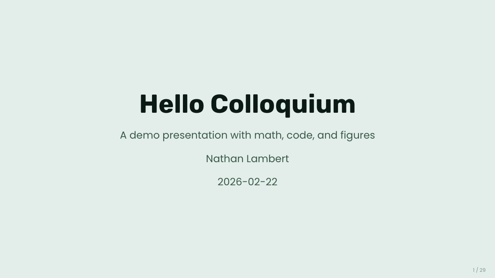
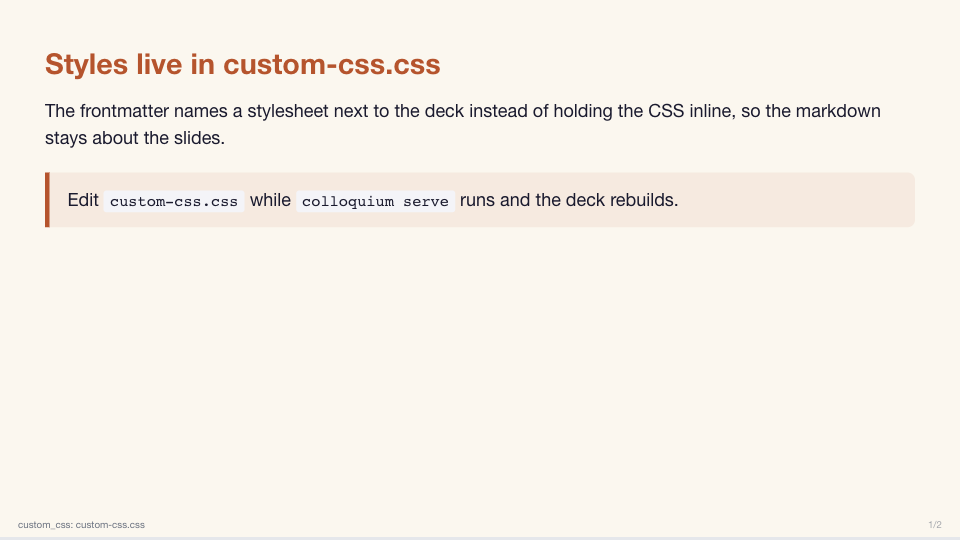
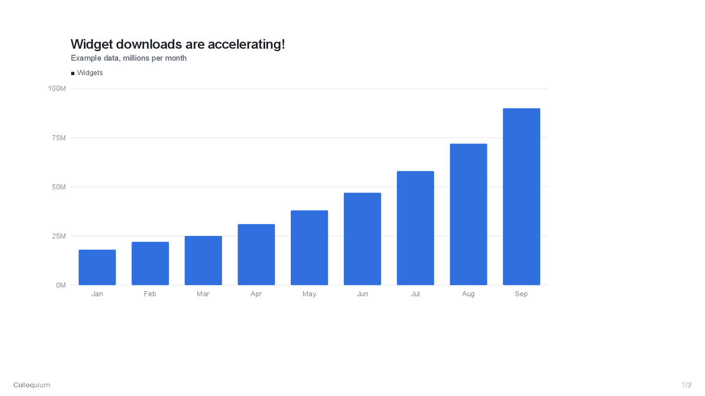

# Colloquium

Markdown-based slide creation tool for research talks. Git-friendly, AI-drivable, single-file HTML output.

**[Docs](https://natolambert.github.io/colloquium/)** · **[Core Example (RLHF Book)](https://rlhfbook.com/course)** · **[PyPI](https://pypi.org/project/colloquium/)**

## Install

Colloquium uses [uv](https://docs.astral.sh/uv/) for fast, reliable Python package management.

```bash
uv tool install colloquium
# or inside a project
uv pip install colloquium
```

For development:

```bash
git clone https://github.com/natolambert/colloquium.git
cd colloquium
uv pip install -e ".[dev]"
```

## Quick Start

Create a markdown file:

```markdown
---
title: "My Talk"
author: "Jane Doe"
date: "2026-02-22"
---

# My Talk

Jane Doe

---

## Key Results

- Finding one
- Finding two

---

## Conclusion

Thanks for listening!
```

Build it:

```bash
colloquium build slides.md        # → slides.html
colloquium serve slides.md        # rebuilds and reloads the browser tab on save
colloquium export slides.md       # PDF via a headless Chromium-based browser
colloquium capture slides.md      # per-slide PNGs for AI review
colloquium share-image slides.md  # first slide as the link-preview card (see below)
```

Add `url` and `share_image: auto` to the frontmatter and the built deck links to that capture, so the URL unfurls like this in Slack, X, or iMessage:



Details in [Share images](#share-images).

## CLI Commands

| Command | Description |
|---------|-------------|
| `colloquium build <file.md>` | Build to self-contained HTML |
| `colloquium serve <file.md>` | Dev server: rebuilds on save and reloads the open browser tab on the same slide (`--no-reload` to only rebuild) |
| `colloquium export <file.md>` | PDF export (requires a Chromium-based browser) |
| `colloquium capture <file.md>` | Capture slides as individual PNGs |
| `colloquium share-image <file.md>` | Capture the first slide as the deck's share (Open Graph) image, `<deck>-share.png` |

## Frontmatter Reference

All configuration goes in the YAML frontmatter block at the top of the file.

```yaml
---
title: "Talk Title"
author: "Author Name"
date: "2026-02-22"
theme: default
aspect_ratio: "16:9"

fonts:
  heading: "Playfair Display"    # Google Font for h1/h2/h3
  body: "Source Sans 3"          # Google Font for body text

footer:
  left: "https://example.com/logo.png"   # image URL → logo, plain text → text
  center: "My Talk Title"
  right: "auto"                           # "auto" → slide numbers "3 / 12"

custom_css: ".slide h2 { color: red; }"   # inline CSS overrides, or a .css file: custom_css: deck.css
---
```

| Key | Default | Description |
|-----|---------|-------------|
| `title` | `"Untitled"` | Presentation title (used in `<title>` and title slides) |
| `author` | `""` | Author name |
| `date` | `""` | Date string |
| `theme` | `"default"` | Theme name |
| `aspect_ratio` | `"16:9"` | Slide aspect ratio |
| `fonts.heading` | Inter | Google Font for headings |
| `fonts.body` | Inter | Google Font for body text |
| `footer.left` | `""` | Left footer zone (text, image URL, or `"auto"`) |
| `footer.center` | `""` | Center footer zone |
| `footer.right` | `"auto"` | Right footer zone (`"auto"` = slide numbers) |
| `custom_css` | `""` | Additional CSS injected into the page: inline CSS, or the path of a `.css` file next to the deck (see [Custom CSS from a file](#custom-css-from-a-file)) |
| `url` | `""` | Canonical URL of the published deck; adds `og:url` and a canonical link, and resolves a relative `share_image` |
| `share_image` | `false` | Share (Open Graph) image: `auto` for `<deck>-share.png` next to the HTML (see [Share images](#share-images)), or a path or URL |
| `pptx` | — | PPTX template export settings; see [PPTX Export](#pptx-export-experimental) |
| `chapters` | `true` | Group slides into [chapters](#chapters); `false` keeps a flat picker |
| `chapter_bar` | `false` | Show the [chapter bar](#chapter-bar): `true`, `bars`, or a mapping of `labels`, `slides`, `progress` |
| `footer.section_break` | — | Footer zones to use on section-break slides (see [Section-break footer](#section-break-footer)) |

Footer text supports `{n}` (slide number) and `{N}` (total slides) for custom counters, e.g. `"Lambert {n}/{N}"` → `"Lambert 6/23"`.

When `footer:` is omitted entirely, a minimal footer with just the slide counter in the right zone is used.

Use `{n}` and `{N}` placeholders to embed the current slide number and total count inline with text:

```yaml
footer:
  left: "rlhfbook.com"
  right: "Lambert {n}/{N}"    # renders as "Lambert 3/25"
```

If no zone uses `"auto"`, `{n}`, or `{N}`, the slide counter is automatically placed in the first empty zone.

### Custom CSS from a file

When a deck's styling grows past a few rules, point `custom_css` at a stylesheet instead of holding the CSS in the frontmatter:

```yaml
custom_css: lecture.css    # a path ending in .css, relative to the markdown file
```

The file's contents are inlined into the built HTML at build time, so the output is still a single self-contained file and PDF export, share images, and hosting work unchanged. `colloquium serve` watches the stylesheet as well as the markdown, so saving either rebuilds and reloads the deck. A missing file is a build error that names the path. See [`examples/custom-css`](examples/custom-css) for a deck styled this way:



## Slide Structure

Slides are separated by `---` on its own line. The first heading in each slide becomes the slide title:

| Heading | Behavior |
|---------|----------|
| `# Title` | Title slide — centered, large text, `slide--title` layout |
| `## Title` | Content slide — standard layout with heading at top |
| `###` through `######` | Rendered as subheadings within slide content |
| `## Line one` directly followed by `## Line two` | One title on two lines (a line break between them); the picker, chapters, and table of contents read it as one line |

```markdown
# Welcome              ← title slide (centered, large)

---

## Key Results         ← content slide (heading + body)

### Sub-section        ← rendered as h3 inside the slide body

Normal paragraph text.
```

## Slide Directives

Per-slide configuration via HTML comments. Place them anywhere in the slide.

```markdown
## My Slide

<!-- layout: section-break -->
<!-- class: highlight special -->
<!-- style: background: #1a1a2e -->
<!-- notes: Remember to mention X -->
<!-- align: center -->
<!-- valign: bottom -->
<!-- columns: 2 -->
<!-- rows: 35/65 -->
<!-- padding: compact -->
<!-- size: large -->
<!-- title: hidden -->
```

### Layouts

| Directive | Effect |
|-----------|--------|
| `<!-- layout: title -->` | Centered title slide (used with `# Heading`) |
| `<!-- layout: title-left -->` | Left-aligned title slide with stacked metadata |
| `<!-- layout: title-sidebar -->` | Wide title with a right-side metadata rail |
| `<!-- layout: title-banner -->` | Editorial title slide with headline up top and metadata near the bottom |
| `<!-- layout: content -->` | Default content layout (used with `## Heading`) |
| `<!-- layout: section-break -->` | Dark accent background, centered text |
| `<!-- layout: two-column -->` | Two-column grid |
| `<!-- layout: image-left -->` | Image on left, text on right |
| `<!-- layout: image-right -->` | Text on left, image on right |
| `<!-- layout: code -->` | Optimized for large code blocks |

### Columns

Split content with `|||` between columns:

```markdown
<!-- columns: 2 -->
## Results

Left column content

|||

Right column content
```

| Value | Effect |
|-------|--------|
| `2` | Two equal columns |
| `3` | Three equal columns |
| `60/40` | 60%/40% split |
| `40/60` | 40%/60% split |
| `70/30` | 70%/30% split |
| `30/70` | 30%/70% split |

Arbitrary numeric ratios are allowed, e.g. `25/75`, `33/67`, or `1/2/1`.

A column that holds an image followed by its caption (a markdown image or raw `` and then a paragraph, or a captioned figure) is a figure column: the image fits the column's height with the caption directly beneath it, and the column keeps the width you chose. Widen the text column and the figure narrows to match. `<!-- img-valign: center -->` or `bottom` moves the figure within the column. Add `<!-- class: img-tall-right -->` to run the last column from the top of the slide, beside the title, to the bottom of the content area while still following the `columns` ratio.

### Rows

Split a slide vertically with `===` between row blocks:

```markdown
<!-- rows: 35/65 -->
## Overview

Top row content

===

Bottom row content
```

| Value | Effect |
|-------|--------|
| `2` | Two equal rows |
| `3` | Three equal rows |
| `60/40` | 60%/40% split |
| `40/60` | 40%/60% split |
| `35/65` | 35%/65% split |
| `65/35` | 65%/35% split |
| `70/30` | 70%/30% split |
| `30/70` | 30%/70% split |

Arbitrary numeric ratios are allowed here too, e.g. `25/75` or `20/30/50`.

To use columns inside a specific row block, add a row-local directive at the top of that row:

```markdown
<!-- rows: 35/65 -->
## Overview

<!-- row-columns: 40/60 -->
Left text

|||

Right text

===


```

At the slide root, use either `columns:` or `rows:`. For nested layouts, use `row-columns:` inside a row block.

### Text & Spacing

| Directive | Values |
|-----------|--------|
| `<!-- align: ... -->` | `left`, `center`, `right` |
| `<!-- valign: ... -->` | `top`, `center`, `bottom` |
| `<!-- size: ... -->` | `small` (20px), `normal` (24px), `large` (28px) |
| `<!-- padding: ... -->` | `compact` (30px), `normal` (60px), `wide` (90px) |
| `<!-- title: ... -->` | `top`, `center`, `hidden` |

### Other

| Directive | Description |
|-----------|-------------|
| `<!-- class: name1 name2 -->` | Add CSS classes to the slide |
| `<!-- style: css-here -->` | Inline CSS on the slide element |
| `<!-- notes: text -->` | Speaker notes (hidden in presentation) |
| `<!-- eyebrow: text -->` | Small uppercase label above the slide heading (e.g. `Part 1` on a section break); fills a template's eyebrow slot in PPTX export |
| `<!-- only: html -->` | Keep this slide out of PPTX export; `only: pptx` keeps it out of the HTML, PDF, and captures (see [HTML-only and PPTX-only slides](#html-only-and-pptx-only-slides)) |
| `<!-- after: references -->` | Move this slide after generated bibliography slides; it is excluded from the footer `{N}` total |
| `<!-- figure-title: heading -->` | The `##` heading replaces the title inside the slide's first SVG figure (see [Plot titles from the heading](#plot-titles-from-the-heading)) |
| `<!-- chapter: Title -->` | Start a new chapter at this slide (see [Chapters](#chapters)) |
| `<!-- chapter-short: Label -->` | Shorter label for this slide's chapter in the [chapter bar](#chapter-bar) |
| `<!-- chapter-bar: bars chapters -->` | Restyle, show, or `hide` the [chapter bar](#chapter-bar) on this slide |
| `<!-- class: figure-captions -->` | Turn standalone markdown images on that slide into numbered figures with captions taken from `` |
| `<!-- class: no-figure-captions -->` | Disable deck-wide figure captions for a specific slide |
| `<!-- img-align: center -->` | Align images only (`left`, `center`, `right`) — title unaffected |
| `<!-- img-valign: top -->` | Vertically align standalone images in grid/row cells (`top`, `center`, `bottom`) |
| `<!-- class: img-tall-right -->` | Columns slides: the last column runs from the top of the slide to the bottom of the content area, beside the title, following the `columns` ratio; its image or captioned figure fills that height with the caption beneath |
| `<!-- img-fill: true -->` | Expand image to fill available slide space |
| `<!-- img-overflow: true -->` | Let images in grid cells bleed outside their box instead of fitting inside |

See the [examples on the website](https://natolambert.github.io/colloquium/) for rendered decks and copy-paste patterns, or browse the source in [`examples/`](./examples/).

### Bibliography

Frontmatter options:

```yaml
bibliography: refs.bib
citation_style: author-year
citation_order: auto
```

- `citation_style: numeric` keeps citations and references in first-appearance order.
- Non-numeric styles default to alphabetical ordering.
- Set `citation_order: appearance` to keep author-year or title-year citations in source order.

To add appendix or backup slides after the automatically generated references, place them at the end of the markdown and add a slide directive:

```markdown
---

<!-- after: references -->

## Backup analysis

Extra material
```

These post-reference slides render after the references section, but they do not contribute to the footer `{N}` total. If the main talk plus generated references totals 30 slides, the first post-reference slide is numbered `31/30`.

### Chapters

Long decks can be split into chapters, which group slides in the slide picker. Every `section-break` slide starts a chapter named after its heading. To start a chapter on any other slide, or to give a section break a shorter name, add a directive:

```markdown
<!-- layout: section-break -->
<!-- chapter: Measuring progress -->

## Part 2: Measuring the open model ecosystem
```

A chapter runs until the next one starts. Slides before the first chapter (title, outline) stay ungrouped at the top of the picker. Generated references form their own "References" chapter, and `after: references` slides join it unless they start a chapter of their own.

When the picker opens, only the current chapter is expanded. Click any chapter to show or hide its slides. Each slide's `<section>` carries `data-chapter="N"`, the first slide of each chapter also has `data-chapter-start`, and `window.colloquium.chapters` lists `{title, start, end}` for every chapter. Custom CSS and scripts can use these.

To turn chapters off and keep a flat picker, set this in the frontmatter:

```yaml
chapters: false
```

#### Chapter bar

Set `chapter_bar: true` in the frontmatter to add a bar along the bottom of each slide, with one labeled segment per chapter. Finished chapters are fully shaded, the current chapter fills as you advance through its slides, and later chapters stay empty. Click a segment to jump to the start of that chapter; hover it to see the chapter's full title.

```yaml
chapter_bar: true    # labeled segments on every slide
chapter_bar: bars    # the same, as thin tracks without labels
```

For more control, give `chapter_bar` a mapping. Each key is optional:

```yaml
chapter_bar:
  labels: true            # false: tracks without labels
  slides: section-breaks  # all (default): every slide; section-breaks: only section breaks
  progress: chapters      # slides (default): the current chapter fills slide by slide
                          # chapters: whole-chapter states (done dimmed, current solid, upcoming empty)
```

`slides: section-breaks` with `progress: chapters` gives a quiet "where are we" indicator on each section break and leaves every other slide alone.

Restyle the bar on one slide with a `chapter-bar` directive, whose tokens override the deck settings for that slide. A directive also shows the bar on its slide when the deck has no `chapter_bar` setting, or when `slides: section-breaks` would leave it out:

```markdown
<!-- chapter-bar: bars chapters -->   tracks only, whole-chapter states
<!-- chapter-bar: labels slides -->   labels, slide-by-slide fill
<!-- chapter-bar: hide -->            no bar on this slide
```

Give a segment a shorter label with `chapter-short` on the slide that opens the chapter. The picker and table of contents keep the full title:

```markdown
<!-- layout: section-break -->
<!-- chapter-short: Why care -->

## Why should we care about open models?
```

- The bar never appears on title slides. Besides `chapter-bar: hide`, the `no-chapter-bar` class also hides it on one slide.
- Segments have equal widths, and long titles are cut off with an ellipsis, so use `chapter-short` when names are long.
- Keep the footer light when the bar has labels: a logo and the slide counter in the corners, with `footer.center` empty. Center text sits directly above the labels and looks crowded. Tracks without labels leave more room.
- The generated References chapter gets no segment.
- With labels, the footer moves up to sit above the bar, and slides lose `--colloquium-chapter-bar-height` (default `30px`) of content height. Tracks without labels only lift the footer slightly and keep the full content height. When the bar is on every slide, the thin progress line at the bottom of the window is hidden.
- The bar is built into each slide, so it also appears in PDF exports and captures. It uses the `--colloquium-progress-fill` and `--colloquium-progress-bg` colors, and turns white on section breaks.

#### Section-break footer

Section breaks sit on the accent color, so a dark logo can disappear. `footer.section_break` overrides any footer zone on section-break slides only:

```yaml
footer:
  left: "assets/logo.png"
  right: "auto"
  section_break:
    left: "assets/logo-white.png"
```

#### Table of contents

A `toc` block lists the deck's chapters, each linked to its first slide:

````markdown
## Outline

```toc
```
````

When the block sits inside a chapter, that chapter is highlighted and the others are dimmed, so the same block repeated at the start of each chapter works as an agenda slide. On a slide before the first chapter, such as an outline, all chapters look the same. The list is numbered by default; set `numbered: false` inside the block for a plain list:

````markdown
```toc
numbered: false
```
````

Like the chapter bar, the table of contents leaves out the generated References chapter. A deck without chapters renders the block as nothing.

See [`examples/chapters/`](./examples/chapters/) for a deck that shows every option above, with a settings summary on its first slides. It is also on the [examples site](https://natolambert.github.io/colloquium/).

## Content Features

**Math** (KaTeX) — inline `$E=mc^2$` and display `$$\sum_{i=1}^n x_i$$`

**Code** (highlight.js) — fenced code blocks with language syntax highlighting

**Tables** — standard markdown tables

**Images** — `` with automatic sizing (SVG supported for vector graphics)

To enable numbered figure captions across a whole deck, add this to frontmatter:

```yaml
figure_captions: true
```

Standalone markdown images will render as numbered figures, using the alt text as the caption:

```markdown

```

This renders as `Figure 1: Training recipe overview`. Leave the alt text empty to suppress the caption:

```markdown

```

Caption text can include bibliography citations, which render as links in the visible caption:

```markdown
![Training recipe overview [@christiano2017]](assets/recipe.png)
```

If you only want captions on selected slides, use `figure-captions` as a slide class instead:

```markdown
<!-- class: figure-captions -->


```

If the deck enables `figure_captions: true`, add `no-figure-captions` to a slide to opt that slide out.

### Text Sizes

Control font size on any element or block using HTML class attributes:

```markdown
<span class="text-2xl">Big emphasis text</span>

Normal paragraph text.

<div class="text-sm">

- Dense bullet point one
- Dense bullet point two

</div>

<span class="text-xs">Footnote or citation</span>

<div class="colloquium-spacer-md"></div>

<div class="colloquium-footnote">
This is useful for speaker-side caveats or details that should stay visually secondary.
</div>
```

| Class | Scale | Use case |
|-------|-------|----------|
| `text-xs` | 0.65em | Footnotes, citations |
| `text-sm` | 0.8em | Dense lists, fine details |
| `text-base` | 1em | Default |
| `text-lg` | 1.2em | Callouts |
| `text-xl` | 1.4em | Key takeaways |
| `text-2xl` | 1.7em | Emphasis |
| `text-3xl` | 2.2em | Large statements |
| `text-4xl` | 2.8em | Hero text |

### Spacing and Footnotes

Use small spacer blocks when you want more breathing room between prose and an example:

```markdown
After pretraining we are left with a glorified autocomplete model.

<div class="colloquium-spacer-md"></div>

```conversation
messages:
  ...
```
```

Available spacer helpers:

- `colloquium-spacer-sm`
- `colloquium-spacer-md`
- `colloquium-spacer-lg`

Use `colloquium-footnote` for secondary caveats or context inside the slide body:

```markdown
<div class="colloquium-footnote">
Base models are also becoming more flexible through midtraining and related data mixtures.
</div>
```

For slide-level footnotes that sit above the footer, use directives:

```markdown
<!-- footnote: Base models are also becoming more flexible through midtraining. -->
<!-- footnote-right: Right-aligned note for this slide. -->
```

These share the same bottom-left / bottom-right area as floating citations, with citations stacked above the footnote when both are present.

For inline numbered footnotes, use `^[...]` where you want the marker to appear:

```markdown
This sentence ends with a numbered footnote.^[Base models are also becoming more flexible through midtraining.]
```

Inline footnotes collect into the same floating footer area and are numbered per slide. They default to the right side; set the side explicitly when needed:

```markdown
<!-- footnotes: left -->
```

Use the dedicated example deck in [`examples/footnotes/`](./examples/footnotes/) for copy-paste patterns.

### Charts

Inline charts via Chart.js using YAML in fenced code blocks:

````markdown
```chart
type: line
height: 500
width: 800
data:
  labels: [Q1, Q2, Q3, Q4]
  datasets:
    - label: Revenue
      data: [10, 25, 40, 60]
      color: "#4AA691"
options:
  scales:
    y:
      ticks:
        prefix: "$"
        suffix: "K"
```
````

| Key | Default | Description |
|-----|---------|-------------|
| `type` | `bar` | Chart type: `line`, `bar`, `scatter`, `pie`, `doughnut` |
| `height` | `400` | Container height in pixels |
| `width` | `100%` | Container width in pixels (omit for full width) |
| `data.labels` | `[]` | X-axis labels |
| `data.datasets[].label` | `"Series N"` | Legend label |
| `data.datasets[].data` | `[]` | Data values |
| `data.datasets[].color` | auto | Series color |
| `options.scales.{x,y}.ticks.prefix` | `""` | Prepend to tick labels (e.g. `"$"`) |
| `options.scales.{x,y}.ticks.suffix` | `""` | Append to tick labels (e.g. `"%"`) |
| `options.scales.{x,y}.grid.display` | `true` | Show/hide grid lines |

### Plot titles from the heading

Exported plots carry their own title text. To retitle one you would normally re-export it; with `figure-title: heading` the slide's `##` heading becomes the figure's title at build time, so editing the heading is enough:

```markdown
<!-- figure-title: heading -->
## Local model downloads are accelerating!


```



The SVG must mark its title with `<text data-role="title">` (the [Interconnects plot exporter](https://github.com/Interconnects-AI/dashboard/tree/main/tools/plots) does). The first title line takes the heading and any further wrapped lines are dropped, so keep headings to one line on these slides. The retitled copy is embedded in the HTML and the original path stays in `data-plot`, so the exporter's hover helper keeps working; the heading itself is hidden on the slide. Figures without the role, remote images, and missing files are left as they are, with a note in the build log.

### Conversations

Render LLM-style chat bubbles using YAML in fenced code blocks:

````markdown
```conversation
size: 0.9
messages:
  - role: user
    content: "What is RLHF?"
  - role: assistant
    model: "Tülu 3 405B"
    content: "**RLHF** is a technique for aligning language models..."
  - role: system
    content: "You are a helpful AI assistant."
```
````

| Role | Styling |
|------|---------|
| `user` | Right-aligned bubble, accent background, white text |
| `assistant` | Left-aligned bubble, code-bg background |
| `system` | Centered, bordered, muted italic text |

Message content supports markdown formatting (bold, italic, inline code).

Optional conversation settings:

| Key | Default | Description |
|-----|---------|-------------|
| `size` | unset | Bubble font scale as a positive numeric value like `0.9` or `1.05` |
| `messages[].model` | unset | Optional model label shown next to the role, e.g. `ASSISTANT (Llama 3.1 405B Base)` |

### Boxes

Render a rounded callout card using YAML in fenced code blocks:

````markdown
```box
title: DPO became popular because:
tone: accent
content: |
  - Far simpler to implement
  - Far cheaper to run
  - Often reaches most of the final performance
```
````

Optional box settings:

| Key | Default | Description |
|-----|---------|-------------|
| `title` | unset | Bold heading shown at the top of the box |
| `tone` | `accent` | Visual style: `accent`, `muted`, or `surface` |
| `content` | unset | Optional markdown body below the title |
| `size` | unset | Font scale as a positive numeric value like `0.9` or `1.05` |
| `align` | unset | Text alignment inside the box: `left`, `center`, or `right` |
| `compact` | `false` | Tighten paragraph and list spacing inside the box |

`box` supports a title-only callout too:

````markdown
```box
title: Core idea
tone: accent
```
````

The supported tones are:

| Tone | Use |
|------|-----|
| `accent` | High-contrast highlight box using the deck accent color |
| `muted` | Softer supporting card using the code/background surface |
| `surface` | Neutral bordered panel for references, caveats, or side notes |

### Built With Badge

Render a compact GitHub badge anywhere in a slide using the normal layout tools:

````markdown
<!-- align: right -->
<!-- valign: bottom -->

```builtwith
repo: natolambert/colloquium
```
````

Optional settings:

| Key | Default | Description |
|-----|---------|-------------|
| `label` | `"Built with"` | Small label above the repo name |
| `repo` | `"natolambert/colloquium"` | GitHub repository slug |
| `url` | `https://github.com/<repo>` | Link target override |
| `stars` | `auto` | Fetch GitHub stars automatically, hide with `false`, or pin a numeric value |
| `icon` | `true` | Show/hide the GitHub icon |

Because it is a normal block element, you can place it with columns, rows, alignment utilities, or raw HTML wrappers instead of relying on footer-specific behavior.

### Citations

Add a `.bib` file to your project and reference it in frontmatter:

```yaml
---
bibliography: refs.bib
citation_style: author-year   # or "numeric" or "title-year"
---
```

Use `[@key]` to cite in slides:

```markdown
The foundational work on RLHF [@christiano2017] introduced reward models.

Multiple citations: [@christiano2017; @ouyang2022]
```

A **References** slide is automatically appended with only the cited works.

| Key | Default | Description |
|-----|---------|-------------|
| `bibliography` | `""` | Path to `.bib` file (relative to markdown file) |
| `citation_style` | `"author-year"` | Citation format: `author-year`, `numeric`, `title-year` |

## Keyboard Shortcuts

| Key | Action |
|-----|--------|
| Right / Space / PgDn | Advance: next reveal step, then next slide |
| Left / PgUp | Back: previous reveal step, then previous slide |
| Down / Up | Jump to next / previous slide, fully revealed |
| 1–9 | Type a slide number to jump to it, fully revealed (Enter commits early, Esc cancels) |
| Home | First slide |
| End | Last slide |
| C | Copy current slide's markdown source |
| F | Toggle fullscreen |
| Escape | Cancel typed number / close picker / exit fullscreen (while fullscreen, the browser always exits fullscreen on Esc — that part can't be deferred) |

Click the slide counter to open the slide picker (grouped by [chapter](#chapters) when the deck has any). Click left 1/3 of screen to go back, right 2/3 to go forward.

## PPTX Export (Experimental)

Export to PowerPoint/Google Slides format:

```bash
uv pip install colloquium[pptx]     # install optional dependency
colloquium export --pptx slides.md  # → slides.pptx
```

This produces a reasonable starting point, but some colloquium features lose fidelity: citations are flattened, math renders as raw LaTeX, and custom themes/CSS aren't applied. Charts and tables become native editable PPTX objects.

### Preparing images for Google Slides (experimental)

```bash
colloquium export talk.md --google-slides resize -o talk-google-slides.pptx
```

This exports a PPTX for import into Google Slides. It also works with an event
template. To make it the deck's default PPTX behavior, use the following
frontmatter and the usual `--pptx` command:

```yaml
pptx:
  google_slides: resize
```

`resize` fits large images within 2000×2000 pixels using Lanczos resampling,
preserves transparency, and embeds the result as a lossless PNG. It keeps each
figure as a single editable picture, never enlarges smaller images, and leaves
source files and slide placement unchanged. This is intended to control the
downsampling ourselves, with a little margin below Google's observed limit.

Google Slides reduced images wider or taller than 2048 pixels during our October
2026 import tests. Increasing the image resolution alone did not prevent that
reduction. An alternative, `--google-slides tile`, divides large figures into lossless PNG tiles no larger
than 1600 pixels on either axis and groups them at the original image's exact
position and size. The test import preserved the tiles byte-for-byte. Smaller
images and native text remain unchanged. Bare `--google-slides` and frontmatter
`google_slides: true` select `tile`; `false` disables preparation. An explicit
CLI mode overrides frontmatter.

In a six-slide comparison, both resized images (2000×786 and 2000×1050) and all
tiles survived native Google Slides import byte-for-byte; the unprepared images
were resampled by Google. The resized inference chart showed smoother lines and
cleaner text than Google's conversion at the same viewing size. This is a
limited comparison, not a guarantee for every image or display. Source image
quality, label size, and the display's resolution still affect legibility.

A tiled figure moves and resizes as a group; to replace or crop it, regenerate
the export from its source. This preserves existing image detail but cannot add
detail to a low-resolution source screenshot. Check the imported deck in
slideshow mode and test copying slides into the conference's destination deck.

### Exporting onto an event's template

When a conference hands you a `.pptx` speaker template, keep writing in markdown and build native, editable slides on the template's own layouts — backgrounds, logos, and heading styles come from the template:

```yaml
pptx:
  template: "~/Downloads/Event Speaker Template.pptx"  # relative to the .md, or ~/absolute
  layouts:                     # colloquium layout -> template slide number (1-based)
    title: {slide: 4, eyebrow: 3, subtitle: 2, photo: 4, name: 6, affiliation: 5}
    section-break: {slide: 9, eyebrow: 2}
    content: {slide: 22, eyebrow: 3}
  font: "Inter"                # body text font; headings keep the template's
  colors: {text: "280016", muted: "706666", accent: "FF0073", link: "D10060"}
  image_background: "FFFFFF"   # optional rounded card behind figures
```

```bash
colloquium export --pptx talk.md                         # uses pptx.template
colloquium export talk.md --template other-template.pptx # override the template
```

- **Layouts** pick a template slide whose *layout* each colloquium layout is built on. `content` is required; title slides fall back to `title`, everything else to `content`. Pick clean layouts (background + logo) — shapes baked into a layout (cards, divider lines) appear on every slide that uses it.
- **Roles** map content onto that layout's placeholders by `idx` (the heading is `idx` 0 unless `heading:` is set). Title slides fill `eyebrow`/`name`/`affiliation`/`subtitle` from the `colloquium-title-*` components and `photo` from the first image; any slide fills `eyebrow` from `<!-- eyebrow: ... -->`. Placeholders left empty are removed. Without a photo, the name and affiliation move into the photo's spot.
- **Sizing** follows the template: headings keep its size but shrink (down to about 70%) to keep each `##` line on one line, section-break and closing-slide text shrinks to stay on the slide, and body text uses the template's body size within 1–1.2× the HTML's.
- **Body content** (paragraphs, bold/italic/links, bullet and numbered lists, `|||` columns, images as markdown or `` tags with their captions, tables as text) is laid out natively under the heading, shrinking text uniformly when a slide is dense. Simple HTML blocks become small text, with empty color-styled `<span>`s rendered as colored swatches (handy for plot legends). Consecutive leading `##` lines become one multi-line title. `cite:` directives, a References slide, `{n}/{N}` footer text, and speaker notes carry over; animations, charts, and math do not.
- SVG figures are rasterized at 2x with the same headless Chromium the PDF export uses (`figure-title: heading` is applied first, and the plot then carries the heading, as in HTML, so the slide doesn't repeat it and the plot takes its space); without a Chromium-based browser they are skipped with a warning. Captions sit centered under their figure, links intact.
- **HTML diagrams** (HTML blocks with nested `<div>`s or an `<svg>`, such as boxes joined by lines) become editable native shapes. Headless Chromium lays out the deck with its custom CSS, finishes every animation, and reports each box (fill, border, rounded corners), text run, SVG line, polyline, rect, circle, and ``; these are drawn as rectangles, text boxes, lines, and pictures. Elements that share a diagram's HTML block (no blank line between them, such as a caption right under it) are measured and exported with it. Theme colors, and tints and shades of them, follow the template's `colors`. Consecutive slides that show the same diagram (the same root tag and classes) share one scale and position, sized to what the steps draw rather than the diagram's root box, and get PowerPoint's Morph transition, which animates boxes between steps much like the deck's CSS animations (Keynote imports it as Magic Move). Without a Chromium-based browser, diagrams fall back to text with a warning.
- Unused template layouts are pruned, so the output doesn't carry the template's sample media. Fonts the template embeds stay embedded.
- To check a result without PowerPoint, `soffice --headless --convert-to pdf talk.pptx` renders it; install the template's fonts first (LibreOffice falls back to a serif otherwise).

Find placeholder `idx` values by opening the template with python-pptx (`[(ph.placeholder_format.idx, ph.name) for ph in prs.slides[3].placeholders]`).

### HTML-only and PPTX-only slides

Some slides only work in one format, such as a live iframe demo or an interactive chart. Mark them with `only`, and give the other format its own version:

````markdown
<!-- only: html -->
## Live demo

```iframe
src: https://example.com/demo
```

---

<!-- only: pptx -->
## Demo


````

`only: html` slides are left out of PPTX export. `only: pptx` slides are left out of the HTML, and so out of the PDF and captures made from it. Slide numbers and `{N}` count only the slides in each output.

### What PPTX export leaves out

Both PPTX exporters build slides natively from the markdown, so features that need the browser are dropped:

- **Skipped with a warning:** `box`, `conversation`, `iframe`, and `builtwith` blocks, and in template mode also `chart` blocks. The plain exporter draws charts as native PPTX charts.
- **Converted:** a `toc` block becomes a native list of chapter titles, with the current chapter in bold.
- **Ignored:** the [chapter bar](#chapter-bar), the slide picker, animations, custom CSS (except in template-mode HTML diagrams, which keep its layout and get Morph between steps), and footer logos in template mode. Template mode puts footer text on content slides only, so `footer.section_break` has no effect there.

Use `only: html` for slides built around a skipped feature, and `only: pptx` for their replacements.

## Share images

Give a deck a preview card on Slack, X, iMessage, and friends by pointing its Open Graph tags at a capture of the first slide:

```yaml
---
title: "Open Weight Language Models"
url: "https://example.com/slides/lecture.html"
share_image: auto
---
```

```bash
colloquium build lecture.md
colloquium share-image lecture.md     # writes lecture-share.png next to lecture.html
```

`share_image: auto` emits `og:image`, `twitter:card`, `og:title`, and `og:description` tags for `<deck>-share.png`, resolved against `url` so scrapers get an absolute address. The capture is the first slide at 1280 × 720 CSS pixels, scaled 2× by default (`--scale 1` for a 1280 × 720 file), with the navigation chrome hidden; it needs a Chromium-based browser like PDF export. Publish the PNG alongside the HTML. A path or URL instead of `auto` uses that image as-is. With `-o`, the command rebuilds the HTML so its `og:image` points at that file instead of the default name (pass the markdown source, not a built HTML file, for this to apply).

## PDF Export

Two options:

1. **Browser**: Open the HTML file and `Cmd+P` / `Ctrl+P` — print CSS makes all slides visible with page breaks, footers with slide numbers included
2. **CLI**: `colloquium export slides.md` uses a headless Chromium-based browser

## Slide Capture

Capture individual slides as 1280x720 PNG images — useful for AI agents to visually review slides, or for thumbnails and previews.

```bash
colloquium capture slides.md              # all slides → slides/ directory
colloquium capture slides.md -o ./imgs/   # custom output directory
colloquium capture slides.md --slide 3    # capture only slide 3
```

This exports to PDF first (one headless Chrome launch), then splits pages into PNGs with Ghostscript. Requires Chrome and `gs`:

```bash
brew install ghostscript   # macOS
apt install ghostscript    # Linux
```

## Output

Everything builds to a single self-contained HTML file. CSS and JS are inlined; math (KaTeX) and code highlighting (highlight.js) load from CDN.

## Contributing Elements

Custom block-level elements live in `colloquium/elements/`. Each module exposes:

- `PATTERN` — compiled regex matching `<pre><code class="language-X">...</code></pre>`
- `process(yaml_str) -> str` — converts the YAML content to HTML
- `reset()` (optional) — resets any counters between builds

The registry in `colloquium/elements/__init__.py` auto-wires them into the build pipeline. To add a new element:

1. Create `colloquium/elements/my_element.py` with `PATTERN`, `process`, and optionally `reset`
2. Import and register it in `colloquium/elements/__init__.py`
3. Add any element-specific CSS to `colloquium/themes/default/theme.css`
